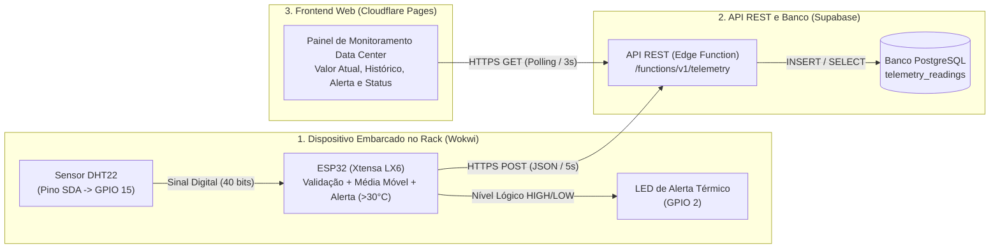

# Relatório Técnico — Projeto Integrador de Monitoramento IoT
**Disciplina:** Arquitetura de Computadores  
**Tema do Projeto:** Monitoramento Térmico de Rack de GPUs em Data Center de IA  
**Arquitetura Adotada:** Opção B — Envio Direto por HTTPS (Wokwi ESP32 → Supabase Edge Function → Supabase PostgreSQL → Cloudflare Pages)

---

## 1. Links Obrigatórios da Entrega

- **Repositório no GitHub:** `https://github.com/Augusto-Otavio/iot-datacenter-ia` *(Repositório público; acessível diretamente pelo professor)*
- **Projeto Simulado no Wokwi (ESP32 + DHT22):** `https://wokwi.com/projects/481616239057175553`
- **Painel Web Publicado (Cloudflare Pages):** `https://iot-datacenter-ia.pages.dev`
- **Endpoint da API REST (Supabase Edge Function):** `https://tvpctlctyjzgdfzcxyus.supabase.co/functions/v1/telemetry`
- **Vídeo de Demonstração (YouTube — Não Listado):** `https://youtu.be/<ID_DO_VIDEO>`

---

## 2. Problema Escolhido e Definições do Sistema

Em **Data Centers de Inteligência Artificial**, clusters de treinamento compostos por múltiplas GPUs e CPUs de alta densidade dissipam grande quantidade de potência térmica (TDP). Caso o sistema de refrigeração apresente queda de eficiência e a temperatura ambiente do rack suba além da faixa operacional recomendada (diretrizes ASHRAE para Data Centers), os processadores entram em regime de ***Thermal Throttling*** (redução drástica da frequência de clock para proteção física do silício) ou sofrem desligamento de emergência, interrompendo cargas críticas de processamento.

Para solucionar esse problema, desenvolvemos um sistema IoT de telemetria térmica para um **Rack de GPUs de IA**:

- **O que é monitorado:** Temperatura do corredor do Rack de GPUs (`device_id: "esp32-rack-ia-01"`, `metric: "temperatura_rack_gpu"`, unidade `°C`) e umidade relativa do ar (`%`), medidas pelo sensor digital **DHT22** acoplado a um microcontrolador **ESP32**.
- **Intervalo de coleta:** As leituras são coletadas e transmitidas a cada **5 segundos (`5000 ms`)**, controlado de forma não-bloqueante pelo registrador de tempo de execução (`millis()`).
- **Tratamento simples aplicado no ESP32:**
  1. **Validação de leitura:** Descarte de leituras corrompidas (`NaN`) ou fora da faixa física operacional do DHT22 (`-40 °C` a `80 °C`).
  2. **Média móvel (3 amostras):** Armazenamento das últimas 3 leituras válidas em um buffer circular na memória SRAM do ESP32, calculando a média aritmética para suavizar flutuações momentâneas do fluxo de ar antes do envio.
  3. **Comparação com limite:** Verificação lógica do valor tratado em relação ao limite térmico máximo do rack.
- **Condição de alerta:** Dispara quando a temperatura média tratada ultrapassa **`30,00 °C`** (`value > 30.00`), acionando imediatamente um atuador visual local (LED vermelho no pino `GPIO 2`) e sinalizando `"alert": true` no pacote enviado à API REST.

---

## 3. Diagrama da Arquitetura da Solução

A solução segue a **Opção B (envio direto por HTTPS)** sugerida no enunciado, integrando os três blocos obrigatórios:

---

## 4. Funcionamento e Relação com Arquitetura de Computadores

### 4.1. Como o ESP32 se comunica com o sensor (Entrada/Saída e Barramento)
O sensor **DHT22** possui internamente um sensor capacitivo de umidade, um termistor NTC e um conversor Analógico-Digital (ADC) próprio de 8 bits. A comunicação entre o DHT22 e o microcontrolador **ESP32** ocorre por meio de um **barramento digital de fio único (*Single-Wire*) conectado ao pino `GPIO 15`**, mapeado nos registradores de Entrada/Saída de Propósito Geral (GPIO) no espaço de endereçamento do ESP32:
1. A CPU do ESP32 configura o registrador de direção do `GPIO 15` como **saída** e coloca a linha em nível lógico baixo (`LOW`) por pelo menos `1 ms` (*sinal de start*), depois libera a linha em nível alto (`HIGH`) e reconfigura o pino como **entrada**.
2. O DHT22 responde assumindo o barramento e transmitindo um quadro serial de **40 bits** (16 bits de umidade, 16 bits de temperatura e 8 bits de *checksum* para verificação de integridade).
3. A distinção entre bit `0` e bit `1` é feita pela duração do pulso em nível alto (`~26–28 µs` para `0` e `~70 µs` para `1`), medida pelos temporizadores de hardware (*timers*) do ESP32.

### 4.2. Onde os dados são processados e armazenados (CPU, Hierarquia de Memória e Nuvem)
O processamento e o armazenamento distribuem-se ao longo de diferentes níveis da hierarquia computacional:
- **No Microcontrolador ESP32 (Borda / Edge):**
  - **Memória Flash (Não-volátil):** Armazena o código de máquina compilado (instruções do firmware) e constantes (`DEVICE_ID = "esp32-rack-ia-01"`, `METRIC_NAME = "temperatura_rack_gpu"`, `TEMP_ALERT_THRESHOLD = 30.0`).
  - **Memória SRAM (Volátil):** Armazena as variáveis em tempo de execução, a pilha de execução (*stack*), o buffer circular de ponto flutuante `tempBuffer[3]` da média móvel e o buffer de caracteres `payload[320]` do JSON.
  - **CPU e ULA/FPU (Xtensa Dual-Core 32-bit LX6):** Executa o ciclo de busca-decodificação-execução das instruções: verifica a validade dos dados (`isnan`), realiza as somas e divisões em ponto flutuante na FPU (*Floating Point Unit*) para calcular a média móvel e executa a comparação lógica (`processedTemp > 30.0`) na Unidade Lógica e Aritmética (ULA).
- **Na API REST e Banco em Nuvem (Supabase):**
  - **Processamento na Edge Function (Deno Runtime):** Ao receber a requisição `HTTPS POST`, a função valida o esquema JSON, identifica o `device_id` e a grandeza `metric`, avalia a regra de alerta e formata a transação SQL.
  - **Armazenamento Persistente (Supabase PostgreSQL):** Como a SRAM do ESP32 é volátil e limitada a poucos kilobytes, o histórico permanente é gravado em disco (SSD em nuvem) na tabela relacional `telemetry_readings`, garantindo durabilidade mesmo que o ESP32 seja reiniciado ou que o painel web esteja fechado.

### 4.3. Como a API REST conecta o dispositivo ao Frontend
A API REST implementada na **Supabase Edge Function** (`/functions/v1/telemetry`) atua como uma camada intermediária de desacoplamento no padrão **Produtor-Consumidor** sobre o protocolo **HTTPS** (HTTP sobre TLS):
- **Ingestão (`HTTPS POST`):** O ESP32 (produtor) serializa a leitura em JSON e envia via requisição `POST`. A API valida os campos (`device_id`, `metric`, `value`, `unit`, `alert`), persiste a linha no PostgreSQL e retorna o código `HTTP 201 Created`.
- **Disponibilização (`HTTPS GET`):** O painel web hospedado no **Cloudflare Pages** (consumidor) realiza requisições `GET` periódicas para a mesma API REST. A API consulta os registros ordenados por `created_at DESC` usando índice B-Tree e devolve um objeto JSON contendo `latest` (leitura mais recente) e `history` (histórico das últimas leituras), com cabeçalhos CORS habilitados.

### 4.4. Como o intervalo de coleta afeta o sistema
A escolha do intervalo de coleta (`5 segundos` no ESP32 e `3 segundos` de consulta no frontend) impacta diretamente quatro dimensões arquiteturais:
1. **Física do sensor e ocupação da CPU:** O sensor DHT22 possui taxa máxima física de amostragem de `0,5 Hz` (1 leitura a cada 2 segundos). Intervalos menores que 2 segundos causariam erros de leitura e bloqueio excessivo de I/O na CPU.
2. **Latência de detecção de alerta vs. Tráfego de rede:** Cada envio `HTTPS POST` exige o estabelecimento de conexão TCP e *handshake* criptográfico TLS na pilha de rede do ESP32, consumindo ciclos de CPU, memória RAM (~40 KB por sessão TLS) e largura de banda. Um intervalo de 5 segundos equilibra resposta rápida a picos térmicos no rack de GPUs com baixo overhead de rede.
3. **Detecção de dados desatualizados (*Stale Data*):** O painel web compara o carimbo de tempo (`created_at`) da última leitura com o relógio atual. Sabendo que o período de transmissão $T = 5\text{ s}$, definiu-se um limiar de tolerância de $3 \times T = 15\text{ s}$. Se nenhuma leitura nova chegar em 15 segundos, o frontend identifica determinísticamente a interrupção da transmissão.
4. **Crescimento de armazenamento no banco:** Com 1 leitura a cada 5 segundos, são gerados `720 registros/hora` (`17.280 registros/dia`). Em cenários reais de longa duração, aumentar o intervalo para 30s ou 60s reduz em até 12x o consumo de disco e de requisições à API.

---

## 5. Testes Realizados e Análise de Resultados

| Cenário de Teste Exigido | Procedimento Executado | Resultado Observado |
| :--- | :--- | :--- |
| **1. Fluxo completo do sensor até o painel** | Simulação iniciada no Wokwi com o DHT22 ajustado em `22,50 °C` e `45%` de umidade (operação normal do Rack de IA). | O ESP32 validou a leitura, calculou a média móvel, enviou via `HTTPS POST` (`HTTP 201`), a API REST registrou o recebimento no banco e o painel exibiu `22,50 °C`, unidade `°C`, horário atualizado e status `NORMAL`. |
| **2. Situação de alerta (Superaquecimento)** | Alterou-se o controle deslizante do DHT22 no Wokwi de `22,50 °C` para `38,00 °C` (acima do limite de `30,00 °C`). | Assim que a média móvel ultrapassou `30,00 °C`, o ESP32 acionou o LED vermelho (`GPIO 2 = HIGH`), enviou `"alert": true` à API e o painel exibiu imediatamente o banner vermelho pulsante de **Superaquecimento no Rack de GPUs**. |
| **3. Interrupção e retomada da transmissão** | Pausou-se a simulação no Wokwi pelo botão *Stop* por mais de 15 segundos e, em seguida, retomou-se a execução. | Após 15 segundos sem novas leituras, o painel mudou automaticamente para **Dados Desatualizados (Transmissão Interrompida)**. Ao retomar o Wokwi, a nova leitura chegou à API e o painel voltou ao estado **Transmissão Ativa (Online)**. |
| **4. Armazenamento com o painel fechado** | A aba do painel web foi fechada por 30 segundos enquanto o ESP32 no Wokwi permaneceu transmitindo leituras a cada 5 segundos. | Ao reabrir o painel web, o gráfico e a tabela de histórico exibiram todas as 6 leituras intermediárias gravadas no Supabase com seus respectivos horários e IDs sequenciais. |

---

## 6. Limitações da Solução

1. **Ausência de buffer offline não-volátil no ESP32:** Caso a conexão Wi-Fi ou a internet caia temporariamente, as leituras geradas durante a queda não são salvas na memória Flash (SPIFFS/LittleFS) para reenvio posterior.
2. **Validação de certificado TLS simplificada no simulador:** No ambiente Wokwi utilizou-se `client.setInsecure()` para evitar o gerenciamento manual da cadeia de certificados raiz (CA Bundle) na memória Flash do ESP32; em produção real, deve-se fixar o certificado raiz (*Root CA*) da plataforma.
3. **Atualização por *Polling* HTTP no Frontend:** O painel consulta a API via `GET` a cada 3 segundos; para milhares de clientes simultâneos, o uso de *WebSockets* ou *Server-Sent Events (SSE)* reduziria requisições redundantes.

---

## 7. Contribuições dos Integrantes

| Nome do Integrante | Usuário GitHub | Principais Contribuições no Desenvolvimento e Apresentação |
| :--- | :--- | :--- |
| **Integrante 1** | `@usuario1` | Desenvolvimento do firmware do ESP32 e circuito no Wokwi (`sketch.ino`, `diagram.json`), implementação do filtro de média móvel e lógica de alerta térmico (> 30 °C). |
| **Integrante 2** | `@usuario2` | Modelagem do banco PostgreSQL no Supabase (`schema.sql`) e desenvolvimento da API REST na Supabase Edge Function (`functions/telemetry/index.ts`). |
| **Integrante 3** | `@usuario3` | Desenvolvimento e publicação do painel Frontend no Cloudflare Pages (`index.html`, `styles.css`, `app.js`), gráfico histórico e detecção de dados desatualizados. |
| **Integrante 4** *(se houver)* | `@usuario4` | Execução da bateria de testes integrados, redação do relatório técnico de Arquitetura de Computadores e gravação/edição do vídeo de demonstração. |
